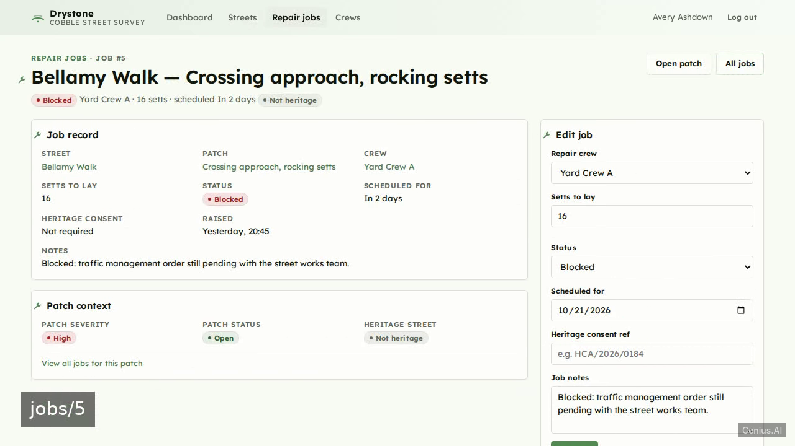
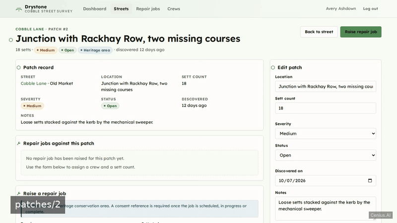
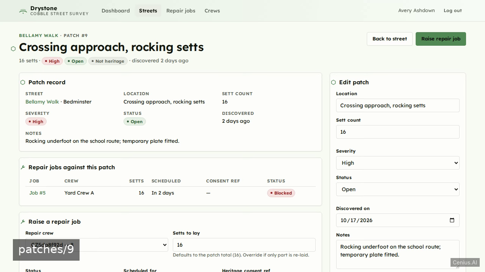
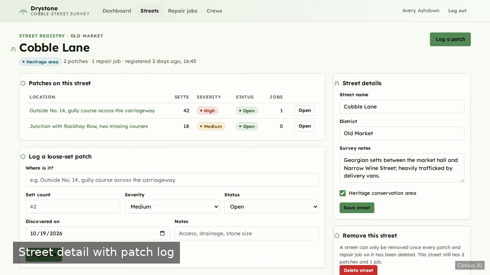

# Drystone Cobble Street Survey — V monitoring dashboard reference implementation

Drystone Cobble Street Survey is a clean, minimal, server-rendered Starlette + Uvicorn + SQLite MVP for a single surveyor/admin role. That's **Drystone Cobble Street Survey** — a Apache-2.0-licensed, open-source monitoring dashboard in V you can self-host and modify freely. Fork Drystone Cobble Street Survey, run it, or [remix it on cenius.ai](https://cenius.ai/marketplace/p/drystone-cobble-street-survey?ref=gh&utm_campaign=drystone-cobble-street-survey-vlang) for a custom Drystone Cobble Street Survey build with full rebrand rights.


[](LICENSE)  [](https://cenius.ai)

[](https://cenius.ai/marketplace/p/drystone-cobble-street-survey?ref=gh&utm_campaign=drystone-cobble-street-survey-vlang)

> **▶ [Open & edit in cenius.ai](https://cenius.ai/marketplace/p/drystone-cobble-street-survey?ref=gh&utm_campaign=drystone-cobble-street-survey-vlang)** — one click to an editable workspace: describe changes in plain English, get an instant preview, one-click deploy and host. Modifications made on the platform come with full rebrand & relicense rights.

_Local clone? See [Quick start](#quick-start) below. cenius.ai is the zero-setup path._

## Demo





📽 **[Demo video on cenius.ai](https://cenius.ai/marketplace/p/drystone-cobble-street-survey?ref=gh&utm_campaign=drystone-cobble-street-survey-vlang)** — the complete run-through · [MP4](.github/media/demo.mp4)

## Screenshots

  

## Usage guide

Open `/` (or `/login`) and sign in with `cenius@cenius.ai` / `cenius`. `/`
always answers with a rendered page: the sign-in card while you are signed out,
the dashboard once the session is established. Every screen below is reachable
from the sticky top navigation; all other routes redirect to `/login` when
there is no session.

### The register in one paragraph

A **street** is registered first. **Patches** (loose cobble sets) hang from a
street and carry a sett count, a severity and an open/repaired status.
**Repair jobs** are raised from a patch, assign one active **crew**, and carry
their own sett count (defaulted from the patch), a status and — on a heritage
conservation area street — a heritage consent reference.

### Dashboard (`/`)

- Open-patch tile counts every patch whose status is not `repaired`.
- Setts-outstanding tile sums the setts across those open patches.
- Streets tile counts the register and how many are heritage conservation areas.
- Repair jobs tile breaks the register down by status (planned, scheduled,
  in progress, complete, blocked) with a bar row per status that links straight
  into the filtered job list.
- Consent-gap tile counts jobs on a conservation-area street with a blank
  consent reference, across **all** statuses — planned jobs included — and lists
  the affected jobs.
- The two recent-activity tables link into patch and job detail pages.

### Streets (`/streets`, `/streets/{id}`)

_Full guide: [`USAGE.md`](USAGE.md)_

## Features

- Surveyor login and session
- Operational dashboard
- Street register with heritage flag
- Loose cobble patch mapping by street
- Crew records
- Repair job assignment with sett count
- Heritage consent reference per job

## Quick start

```bash
./install.sh   # installs dependencies + seeds demo data
```

See [`INSTALL.md`](INSTALL.md) for full setup and usage instructions.

## Architecture

The setup script (`install.sh`) installs runtime dependencies and loads a starter dataset so the app is immediately usable. The V codebase (61 files) is self-contained — no external services needed to evaluate it. Top-level layout: `app/`, `static/`, `templates/`, `tests/`. Step-by-step setup guide: [`INSTALL.md`](INSTALL.md).

## FAQ

### How do I get Drystone Cobble Street Survey running locally?

Grab the repo and run `./install.sh` — it handles packages and seed data in one go. After that, [`INSTALL.md`](INSTALL.md) walks you through starting the server. No external accounts required.

### Is Drystone Cobble Street Survey free for commercial use?

Yes — it ships under the Apache-2.0 license, which permits commercial use, modification and redistribution. The full text is in [LICENSE](LICENSE).

### Can I rebrand or white-label Drystone Cobble Street Survey?

Yes. The MIT license lets you remove the original branding and ship under your own name. For a guided approach, [remix it on cenius.ai](https://cenius.ai/marketplace/p/drystone-cobble-street-survey?ref=gh&utm_campaign=drystone-cobble-street-survey-vlang): you get a fresh build with full rebrand and relicense rights.

### Is Drystone Cobble Street Survey editable without a developer?

Describe what you want changed on [cenius.ai](https://cenius.ai/marketplace/p/drystone-cobble-street-survey?ref=gh&utm_campaign=drystone-cobble-street-survey-vlang) — no code editing needed; the platform produces a fresh build you can download and deploy.

### How is Drystone Cobble Street Survey built technically?

Powered by V. This repo is the real thing — full source, seed data, and all — ready to clone and start up. Highlights include repair job assignment with sett count.

## License & rebranding

Released under the [Apache License 2.0](LICENSE) (© 2026 Cenius AI) — free for personal and commercial use. The Cenius name/logo are trademarks (see NOTICE).

**Need a customized version?** [Remix this app on cenius.ai](https://cenius.ai/marketplace/p/drystone-cobble-street-survey?ref=gh&utm_campaign=drystone-cobble-street-survey-vlang) — modifications made on the platform come with **full rebrand & relicense rights** over your derivative.

## Built with cenius.ai

This entire application — code, design, seeded demo data — was generated on **[cenius.ai](https://cenius.ai)** from a plain-English description.

- 🚀 [Build your own app on cenius.ai](https://cenius.ai)
- 🎛️ [Remix Drystone Cobble Street Survey on the marketplace](https://cenius.ai/marketplace/p/drystone-cobble-street-survey?ref=gh&utm_campaign=drystone-cobble-street-survey-vlang) — open it in a workspace, prompt for changes, and ship your own version.

More open-source apps: [the Cenius-ai catalog](https://github.com/Cenius-ai) · [showcase index](https://github.com/Cenius-ai/showcase)
